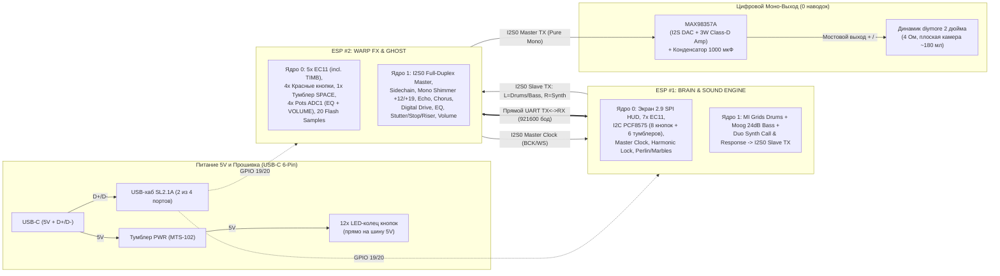

# CYBER-DECK ONE — Генеративный Мультижанровый Синтезатор (V5.1 Pure Digital Mono)

**CYBER-DECK ONE** — тонкий автономный настольный грувбокс и генеративный синтезатор (`248 x 228 x 32 мм`), построенный на связке из **двух** микроконтроллеров `ESP32-S3 N16R8`, одного I2C-расширителя `PCF8575` и одного цифрового I2S ЦАП+усилителя **`MAX98357A`** в цельном 3D-печатном корпусе.

Главная задача инструмента: дать человеку **без музыкального образования** возможность вживую крутить ручки, щелкать тумблерами и нажимать боевые кнопки эффектов, гарантированно получая **100% гармоничную, плотную и не повторяющуюся музыку** в жанрах **Techno**, **Synthwave (Synth-Meat)** и **Lo-Fi**.

---

## Ключевые принципы финальной архитектуры (V5.1)

1. **Чистый цифровой моно-тракт до самого динамика (`MAX98357A`):** Звук идет строго в цифре (`I2S0`) от генераторов до встроенного 2-дюймового динамика в плоской герметичной камере (`~180 мл` с подиумом `+7.5 мм`). Исключены `PCM5102A`, шумодав `BA3121`, усилитель `PAM8406`, разъем `3.5 мм` и вся аналоговая обвязка — **нулевой риск USB-писка и земляных петель**.
2. **Оптимальный 2-платный кластер без шилдов (`ESP #1` + `ESP #2` + `PCF8575`):** Внутри тонкого корпуса (`32 мм`) на печатном мостике `pcb_bridge` установлены всего **2 голые платы `ESP32-S3 DevKitC-1 N16R8`** (4 ядра по `240 МГц`, `16 МБ Flash` + `8 МБ Octal PSRAM`), I2C-экспандер `PCF8575` (все `16` пинов в деле под кнопки и тумблеры) и мини-плата `MAX98357A`. Все `12` быстрых энкодеров `EC11` заведены строго на прямые пины `ESP32`.
3. **Честная эргономика без `Push+Turn` и симметрия `3 x (2x2)`:** Одна ручка = одна функция. На панели с шагом `30-32 мм` и подписями размещены `12` энкодеров `EC11`, `8` тумблеров (`5x MTS-102` + `3x MTS-103`), `12` металлических кнопок `12mm LED` (подсветка запитана напрямую от шины `5 В` без транзисторов), `4` потенциометра `10 кОм` (`HIGH / MID / LOW` + `VOLUME`) и дисплей `~2.9"` (SPI).
4. **Dual-Mono Stem I2S -> Pure Mono DSP:** Между `ESP #1` и `ESP #2` по стандартной 2-канальной шине `I2S0` летят два раздельных моно-ствола (`Slot L` = Драм+Бас, `Slot R` = Синтезатор) для хирургически чистого сайдчейна. Внутри `ESP #2` вся обработка (Shimmer `+12/+19`, Tape Echo, Mono Chorus, Digital Diode Drive, EQ, Stutter/Stop/Riser) выполняется в 1 канал — это снижает нагрузку на CPU и PSRAM почти вдвое.
5. **Без MicroSD-карт и прошивка по одному `USB-C`:** Атмосфера `Ghost Ether` синтезируется процедурно, а ~20 радио-сэмплов вшиты во Flash `ESP #2`. Внутренний USB-хаб `SL2.1A` подключен к `GPIO 19/20` обеих плат. При подключении к ПК `ESP #1` автоматически включает `USB Safe Mode` (лимит цифровой громкости до `20%`), защищая USB-порт ноутбука от перегрузки.

---

## Системная архитектура

---

## Структура документации и файлов репозитория

* [`docs/CONCEPT_AND_CONTROLS.md`](docs/CONCEPT_AND_CONTROLS.md) — эргономика панели `248 x 228 x 32 мм`, карта всех подписей, логика 3 линий и 12 кнопок (`3 x (2x2)`), цифровой `VOLUME`, цифровой овердрайв `DRV` и моно-эффекты.
* [`docs/HARDWARE_BOM.md`](docs/HARDWARE_BOM.md) — предельно компактный BOM на 2 платы `ESP32-S3` + `PCF8575` + `MAX98357A`, экран `~2.9"` SPI, крепеж корпуса и расчет токов (`~350 мА` от ПК).
* [`docs/WIRING_AND_PINOUT.md`](docs/WIRING_AND_PINOUT.md) — безальтернативная карта `26/26` чистых GPIO на обеих платах, полная карта `16/16` входов `PCF8575` и 5-проводное подключение `MAX98357A`.
* [`docs/PROTOCOL_AND_DSP.md`](docs/PROTOCOL_AND_DSP.md) — структура PlatformIO (`esp1_brain_sound`, `esp2_warp_fx`), распределение 4 ядер FreeRTOS, `I2S0 Full-Duplex`, парные 16-байтные пакеты UART и карта Flash/PSRAM `ESP #2`.
* [`cad/cyber_deck_slim_acoustic.scad`](cad/cyber_deck_slim_acoustic.scad) — параметрический 3D-корпус OpenSCAD (`Rev 5.1`, один стол Bambu Lab P1S `256 x 256 мм`, `0` поддержек, чистый задний торец только с `USB-C`, просторный мостик `pcb_bridge` под 2x `ESP32-S3` + `PCF8575` + `MAX98357A`).

---

## Дорожная карта сборки

1. **Калибровка и 3D-корпус:** Подставить реальные замеры экрана `~2.9"` и динамика в `cad/cyber_deck_slim_acoustic.scad`, напечатать `top_shell`, `bottom_lid`, `pcb_bridge` и `accents`, вплавить `17` латунных втулок `M3`.
2. **Стенд I2S + `MAX98357A` на столе:** Проверить цифровую цепочку `ESP #1` <-> `ESP #2` -> `MAX98357A` -> `diymore 2"` (убедиться в полной тишине в паузах и четкой работе `I2S0 Full-Duplex`).
3. **USB-хаб и базовый каркас кода:** Подпаять `SL2.1A` к `GPIO 19/20` обеих плат, поднять PlatformIO с 2 окружениями (`esp1_brain_sound`, `esp2_warp_fx`), прямой `UART` и опрос `PCF8575` + 12 энкодеров + 4 потенциометров `ADC1`.
4. **Финальный монтаж и DSP:** Закрепить фурнитуру на `top_shell`, уложить платы на `pcb_bridge`, распаять короткими проводами, запустить Smart HUD на экране `2.9"`, движки синтеза (`MI Grids` / `Moog` / `Marbles`), моно-эффекты и банк ~20 радио-сэмплов во Flash.
