# CYBER-DECK ONE — Генеративный Мультижанровый Синтезатор (V5.0 Dual-ESP32)

**CYBER-DECK ONE** — тонкий настольный аппаратный грувбокс и генеративный синтезатор (`248 x 228 x 32 мм`), построенный на связке из **двух** микроконтроллеров `ESP32-S3 N16R8` и одного I2C-расширителя `PCF8575` в цельном 3D-печатном корпусе.

Главная задача инструмента: дать человеку **без музыкального образования** возможность вживую крутить ручки, щелкать тумблерами и нажимать боевые кнопки эффектов, гарантированно получая **100% гармоничную, плотную и не повторяющуюся музыку** в жанрах **Techno**, **Synthwave (Synth-Meat)** и **Lo-Fi**.

## Ключевые принципы финальной архитектуры (V5.0)

1. **Оптимальный 2-платный кластер без шилдов (`ESP #1 Brain+Sound` + `ESP #2 Warp FX`):** Внутри плоского корпуса (`32 мм`) на внутреннем печатном мостике `pcb_bridge` стоят всего **2 голые платы `ESP32-S3 DevKitC-1 N16R8`** (4 ядра по `240 МГц`, по `16 МБ Flash` и `8 МБ Octal PSRAM`) и 16-битный I2C-экспандер `PCF8575` под медленные кнопки/тумблеры. Все 12 быстрых энкодеров `EC11` заведены строго на прямые пины `ESP32`.
2. **Честная эргономика без `Push+Turn` и симметрия `3 x (2x2)`:** Одна ручка = одна функция. На панели с шагом `30-32 мм` и короткими подписями размещены `12` энкодеров `EC11`, `8` тумблеров, `12` металлических 12-мм кнопок с LED-кольцами (запитаны напрямую от шины `5 В` — ровное постоянное свечение без лишних транзисторов), вертикальный 3-полосный EQ-стрип (`HIGH/MID/LOW`) и дисплей `~2.9"` (SPI).
3. **Dual-Mono Stem I2S -> True Stereo Out + Встроенный Моно-Динамик:**
   * Между `ESP #1` и `ESP #2` по стандартной 2-канальной шине `I2S0` летят два раздельных моно-ствола (`Slot L` = Драм+Бас, `Slot R` = Синтезатор) — это дает хирургически чистый сайдчейн без сложного TDM.
   * Внутри `ESP #2` стерео-эффекты (Stereo Shimmer `+12/+19`, Ping-Pong Echo, Juno-60 Stereo Chorus, Auto-Pan) разворачивают микс в **настоящее Стерео** на выходе `PCM5102A -> BA3121 -> Stereo Analog Overdrive (1N4148)`.
   * При подключении наушников, AUX автомобиля или внешнего Bluetooth TX-адаптера в гнездо `3.5 мм PJ-392A` идет чистое **True Stereo**, а динамик отключается. Без кабеля стерео-сигнал пассивно суммируется в моно (`2 x 1 кОм`) на 1 канал усилителя `PAM8406` и встроенный 2-дюймовый динамик в плоской герметичной камере (`~180 мл` с подиумом `+7.5 мм`).
4. **Без MicroSD-карт и без UART-кольца:** Атмосфера `Ghost Ether` синтезируется процедурно, а ~20 радио-сэмплов вшиты в `16 МБ` внутренней Flash `ESP #2`. Вместо кольца — простой прямой дуплексный `UART` (`TX <-> RX`) на `921 600` бод.
5. **Умное питание и прошивка по одному `USB-C`:** Внутренний USB-хаб `SL2.1A` подключен к `GPIO 19/20` обеих плат (заняты 2 порта из 4). При подключении к ПК `ESP #1` автоматически включает `USB Safe Mode` (лимит цифровой громкости до `20%`), чтобы не перегрузить USB-порт ноутбука; от Powerbank (`5 В / 2 А`) прибор работает на `100%`.

## Системная архитектура

```mermaid
flowchart LR
    subgraph PWR["Питание 5V и Прошивка (USB-C 6-Pin)"]
        USBC["USB-C (5V + D+/D-)"]
        SWPWR["Тумблер PWR (MTS-102)"]
        HUB["USB-хаб SL2.1A (2 из 4 портов)"]
        LEDS["12x LED-колец кнопок<br/>(прямо на шину 5V)"]
        USBC -->|"5V"| SWPWR
        SWPWR -->|"5V"| LEDS
        USBC -->|"D+/D-"| HUB
    end

    subgraph ESP1["ESP #1: BRAIN & SOUND ENGINE"]
        CORE0_1["Ядро 0: Экран 2.9 SPI HUD, 7x EC11,<br/>I2C PCF8575 (8 кнопок + 4 тумблера),<br/>Master Clock, Harmonic Lock, Perlin/Marbles"]
        CORE1_1["Ядро 1: MI Grids Drums + Moog 24dB Bass +<br/>Duo Synth Call & Response -> I2S0 Slave TX"]
    end

    subgraph ESP2["ESP #2: WARP FX & GHOST"]
        CORE0_2["Ядро 0: 5x EC11 (incl. TIMB),<br/>4x Красные кнопки, 2x Тумблера,<br/>3x EQ Pots (ADC1), 20 Flash Samples, VU"]
        CORE1_2["Ядро 1: I2S0 Full-Duplex Master,<br/>Sidechain, Stereo Shimmer +12/+19, Echo,<br/>Chorus, EQ, Stutter/Stop/Riser -> Stereo Out"]
    end

    subgraph ANALOG["Стерео Аналоговый Тракт + Моно-Динамик"]
        DAC["PCM5102A Stereo DAC"]
        ISO["BA3121 Stereo Шумодав"]
        DRV["2x Резистор 1.5 кОм +<br/>MTS-203 (DPDT) + 10x 1N4148"]
        JACK["PJ-392A 3.5mm Stereo Jack<br/>(Наушники / AUX / BT TX)"]
        SUM["Моно-сумматор<br/>2x Резистор 1 кОм"]
        AMP["PAM8406 (1 канал L)<br/>Master Volume"]
        SPK["Динамик diymore 2 дюйма<br/>(Плоская камера ~180 мл)"]
        DAC -->|"L+R"| ISO -->|"L+R"| DRV -->|"L+R"| JACK
        JACK -->|"Размыкатель L+R"| SUM --> AMP --> SPK
    end

    HUB -.->|"GPIO 19/20"| ESP1
    HUB -.->|"GPIO 19/20"| ESP2

    ESP1 <==>|"Прямой UART TX<->RX (921600 бод)"| ESP2

    ESP1 -->|"I2S0 Slave TX: L=Drums/Bass, R=Synth"| ESP2
    ESP2 -->|"I2S0 Master Clock (BCK/WS)"| ESP1
    ESP2 -->|"I2S0 Master TX (True Stereo L/R)"| DAC
```

## Структура документации и файлов репозитория

* [`docs/CONCEPT_AND_CONTROLS.md`](docs/CONCEPT_AND_CONTROLS.md) — эргономика панели `248 x 228 x 32 мм`, карта всех подписей, логика 3 линий и 12 кнопок (`3 x (2x2)`), движки синтеза, стерео-эффекты и «Ghost Ether» во Flash.
* [`docs/HARDWARE_BOM.md`](docs/HARDWARE_BOM.md) — актуальный BOM на 2 платы `ESP32-S3` + `PCF8575`, экран `~2.9"` SPI, стерео-тракт (`MTS-203`, `1N4148`, резисторы), крепеж корпуса и бюджет питания.
* [`docs/WIRING_AND_PINOUT.md`](docs/WIRING_AND_PINOUT.md) — безальтернативная карта пинов обеих плат `ESP32-S3 N16R8` и расширителя `PCF8575`, схемы шин `I2S0` / `UART` / `USB`, прямого питания подсветки и стерео-аналогового тракта.
* [`docs/PROTOCOL_AND_DSP.md`](docs/PROTOCOL_AND_DSP.md) — структура PlatformIO (`esp1_brain_sound`, `esp2_warp_fx`), распределение 4 ядер FreeRTOS, `I2S0 Full-Duplex`, парные 16-байтные пакеты UART и карта Flash/PSRAM `ESP #2`.
* [`cad/cyber_deck_slim_acoustic.scad`](cad/cyber_deck_slim_acoustic.scad) — параметрический 3D-корпус OpenSCAD (`Rev 5.0`, один стол Bambu Lab P1S `256 x 256 мм`, `0` поддержек, мостик `pcb_bridge` под 2 платы + `PCF8575`, опция 2-цветных подписей AMS).

## Дорожная карта сборки

1. **Калибровка и 3D-корпус:** Подставить точные замеры экрана `~2.9"` и динамика в `cad/cyber_deck_slim_acoustic.scad`, напечатать `top_shell`, `bottom_lid`, `pcb_bridge` и `accents`, вплавить `17` латунных втулок `M3`.
2. **Стенд I2S + Аналог на столе:** Проверить связку `ESP #1` <-> `ESP #2` -> `PCM5102A` -> `BA3121` -> стерео-диоды `1N4148` -> `PJ-392A` -> сумматор `2 x 1 кОм` -> `PAM8406` -> динамик.
3. **USB-хаб и базовый каркас кода:** Подпаять `SL2.1A` к `GPIO 19/20` обеих плат, поднять PlatformIO с 2 окружениями (`esp1_brain_sound`, `esp2_warp_fx`), прямой `UART` и опрос `PCF8575` + энкодеров.
4. **Финальный монтаж и DSP:** Закрепить фурнитуру на `top_shell`, уложить платы на `pcb_bridge`, распаять короткими проводами, поднять Smart HUD на экране `2.9"`, движки синтеза (`MI Grids` / `Moog` / `Marbles`), стерео-эффекты и банк из ~20 радио-сэмплов во Flash.
