# CYBER-DECK ONE — Генеративный Мультижанровый Синтезатор (V4.0 Final)

**CYBER-DECK ONE** — настольный аппаратный грувбокс и генеративный синтезатор, построенный на кластере из трех микроконтроллеров `ESP32-S3 N16R8` в одном корпусе.

Главная задача инструмента: дать человеку **без музыкального образования** возможность вживую крутить ручки, переключать тумблеры и нажимать боевые кнопки эффектов, гарантированно получая **100% гармоничную, плотную и не повторяющуюся музыку** в жанрах **Techno**, **Synthwave (Synth-Meat)** и **Lo-Fi**.

## Ключевые принципы финальной архитектуры

1. **Трехплатный кластер (`1 UI/Brain + 2 DSP`):** Внутри корпуса работают 3 одинаковые платы `ESP32-S3 N16R8` (16 МБ Flash, 8 МБ Octal PSRAM) на винтовых клеммных базах `S3 Expansion Board A`. Каждая плата обслуживает только свою горизонтальную линию органов управления короткими проводами.
2. **Честная эргономика без `Push+Turn`:** Никаких скрытых меню и двойных комбинаций. Одна ручка = одна функция. Энкодеры `EC11` только вращаются, тумблеры фиксируют режимы, металлические 12-мм кнопки работают по удержанию/клику и имеют индивидуальную ШИМ-подсветку.
3. **Чистое Моно и Dual-Mono I2S Stem-шина:** Отказ от стерео на компактном корпусе позволил использовать один 2-дюймовый динамик в большом закрытом боксе для лучшего баса, снизить нагрузку на DSP и питание вдвое, а стандартную 2-канальную шину I2S превратить в два независимых моно-канала:
   * **Канал `L`:** Драм-машина + Бас (`PULSE-FORGE`)
   * **Канал `R`:** Полифонический дуэт синтезаторов (`MIND-WEAVER`)
   Плата эффектов принимает оба канала раздельно и делает хирургически чистый сайдчейн от бочки.
4. **Без MicroSD-карт и внешних носителей:** Радио-эфир (`Ghost Ether`) генерируется процедурно в реальном времени, а ~20 коротких голосовых и радио-сэмплов (номерные станции, переговоры, импульсы) вшиты прямо во внутреннюю 16 МБ Flash-память `ESP #3` в виде C-массивов.
5. **Умное питание и единая прошивка:** Все 3 платы шьются и отлаживаются через один внешний порт `USB-C` (внутренний хаб `SL2.1A`). При подключении к ПК система автоматически приглушает громкость и яркость подсветки, защищая USB-порт ноутбука; при питании от Powerbank (5 В / 3 А) работает на 100%.

## Системная архитектура

```mermaid
flowchart LR
    subgraph PWR["Питание и Прошивка (USB-C 6-Pin)"]
        USBC["USB-C (5V + D+/D-)"]
        SWPWR["Тумблер POWER (MTS-102)"]
        HUB["USB-хаб SL2.1A (3 из 4 портов)"]
        USBC -->|"5V"| SWPWR
        USBC -->|"D+/D-"| HUB
    end

    subgraph ESP1["ESP #1: BRAIN & UI (Линия 1 + Верх)"]
        UI1["Ядро 0: OLED 128x64 HUD,<br/>3x EQ Pots, Линия 1, USB Check"]
        GEN1["Ядро 1: Master Clock, Harmonic Lock,<br/>Perlin + Euclid + Marbles Deja Vu"]
    end

    subgraph ESP2["ESP #2: SOUND ENGINE (Линия 2)"]
        DRM2["Ядро 0: MI Grids Drums +<br/>Moog 24dB Bass + Growl + Линия 2"]
        SYN2["Ядро 1: Duo Synth Call & Response<br/>(Supersaw / Pad / FM) + Swell"]
    end

    subgraph ESP3["ESP #3: WARP FX & GHOST (Линия 3)"]
        GHO3["Ядро 0: Линия 3, Procedural Ether,<br/>20 Flash Samples, Audio Meter"]
        FX3["Ядро 1: Sidechain, Shimmer +12/+19,<br/>Echo, 3-Band EQ, Stutter/TapeStop/Riser"]
    end

    subgraph ANALOG["Аналоговый Моно-Тракт"]
        DAC["PCM5102A DAC"]
        ISO["BA3121 Шумодав"]
        DRV["Резистор 1-2.2 кОм +<br/>MTS-103 + Диоды 1N4148"]
        JACK["PJ-392A 3.5mm Jack<br/>(L+R моно в наушники)"]
        AMP["PAM8406 (1 канал L)<br/>Master Volume"]
        SPK["Динамик diymore 2 дюйма<br/>(5 Вт, 4 Ом)"]
        DAC --> ISO --> DRV --> JACK --> AMP --> SPK
    end

    HUB -.->|"GPIO 19/20"| ESP1
    HUB -.->|"GPIO 19/20"| ESP2
    HUB -.->|"GPIO 19/20"| ESP3

    ESP1 ==>|"UART Ring TX->RX (921600)"| ESP2
    ESP2 ==>|"UART Ring + Kick Gate"| ESP3
    ESP3 ==>|"UART Ring (HUD + VU Bars)"| ESP1

    ESP2 -->|"I2S Slave TX: L=Drums/Bass, R=Synth"| ESP3
    ESP3 -->|"I2S0 Master Clock (BCK/WS)"| ESP2
    ESP3 -->|"I2S0 Master TX (Mono Mix)"| DAC
```

## Структура документации репозитория

* [`docs/CONCEPT_AND_CONTROLS.md`](docs/CONCEPT_AND_CONTROLS.md) — раскладка лицевой панели (Мастер-секция + 3 линии), назначение всех ручек/тумблеров/кнопок, движки синтеза, эффекты, «Ghost Ether» без SD-карты и анимация запуска.
* [`docs/HARDWARE_BOM.md`](docs/HARDWARE_BOM.md) — актуальный список комплектующих (BOM), учет имеющихся деталей, резерв и расчет энергопотребления.
* [`docs/WIRING_AND_PINOUT.md`](docs/WIRING_AND_PINOUT.md) — безальтернативная карта пинов всех 3 плат `ESP32-S3 N16R8`, схемы подключения I2S, UART-кольца, USB-хаба и моно-аналогового тракта с диодным клиппингом.
* [`docs/PROTOCOL_AND_DSP.md`](docs/PROTOCOL_AND_DSP.md) — структура бинарного UART-пакета, архитектура I2S Full-Duplex Dual-Mono, распределение ядер FreeRTOS и формат хранения 20 сэмплов во Flash.

## Дорожная карта сборки (Этапы)

1. **Стенд на столе (I2S + Аналог):** Собрать связку `ESP #2` ↔ `ESP #3` → `PCM5102A` → `BA3121` → резистор + диоды `1N4148` → `PAM8406` → динамик. Проверить работу `I2S0 Full-Duplex Master` на `ESP #3` (синусоида в канале `L` и пила в канале `R` с `ESP #2`).
2. **Шина синхронизации и USB-хаб:** Подключить `SL2.1A` к `GPIO 19/20` всех 3 плат, настроить `platformio.ini` с тремя окружениями (`brain`, `sound`, `fx`) и поднять UART-кольцо на 921 600 бод.
3. **Подключение UI и каскадный старт:** Подключить OLED, 3 потенциометра EQ, энкодеры, тумблеры и кнопки с ШИМ-подсветкой. Отладить Smart HUD, авто-ограничение при работе от ПК и стартовую анимацию.
4. **Звуковые движки и эффекты:** Подключить **DaisySP** и алгоритмы **Mutable Instruments** (`Grids`, `Marbles`), зашить банк из 20 радио-сэмплов во Flash `ESP #3`.
5. **Финальная сборка в 3D-корпус:** Разработка корпуса, акустического бокса под динамик `diymore 2"` и монтаж панелей *(отдельный этап)*.
