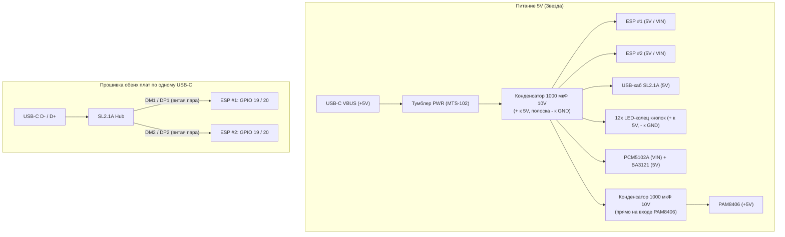
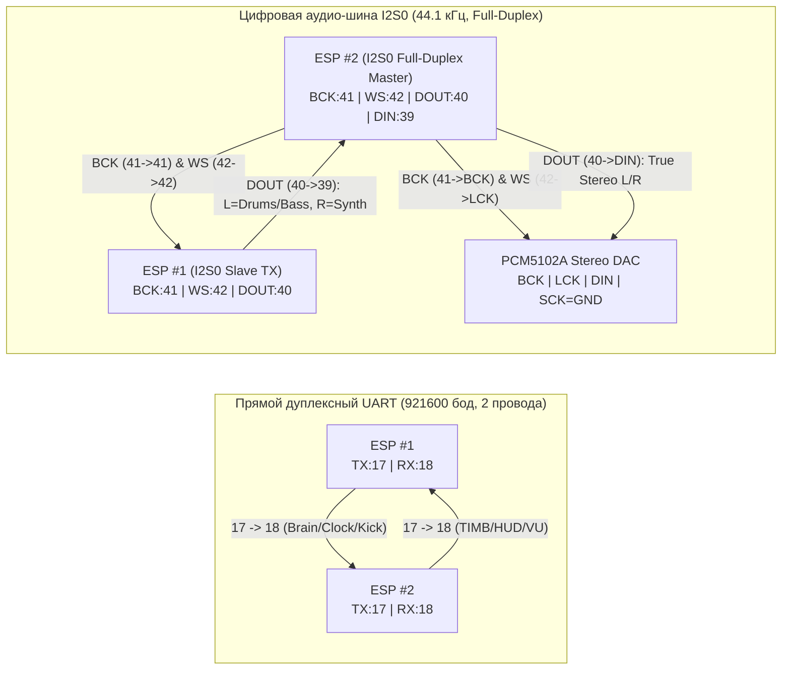
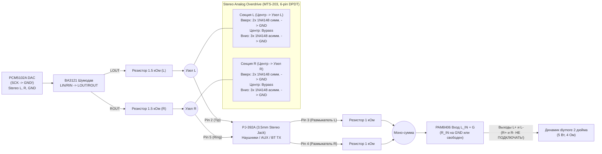

# Безальтернативная карта пинов и Схемы распайки (V5.0 Dual-ESP32)

Обе голые платы `ESP32-S3 DevKitC-1 N16R8` и платка `PCF8575` устанавливаются на внутренний печатный мостик `pcb_bridge` выводами вверх (под прямую пайку или низкопрофильные разъемы).

> **ЗОЛОТОЕ ПРАВИЛО ПИНОВ `ESP32-S3 N16R8` (Octal PSRAM):**
> * **`GPIO 26-37` — ЗАПРЕЩЕНЫ** (заняты внутри чипа под 8 МБ Octal PSRAM и 16 МБ Flash).
> * **`GPIO 19, 20` — ТОЛЬКО USB** (подключены к внутреннему хабу `SL2.1A`).
> * **`GPIO 0, 45, 46` — НЕ ИСПОЛЬЗУЕМ** (загрузочные strapping-пины; подача HIGH на `GPIO 45` при старте нарушает питание Flash/PSRAM).
> * **`GPIO 43, 44` — СВОБОДНЫЙ РЕЗЕРВ** (в базовой схеме `V5.0` не задействованы; при желании `GPIO 43` на `#1` можно пустить на подсветку TFT-экрана, а `GPIO 44` на клик энкодера `BPM`).

## 1. Карта пинов обеих плат `ESP32-S3 N16R8` (26 из 26 чистых GPIO на каждой)

| Узел / Функция | `ESP #1`: BRAIN & SOUND ENGINE | `ESP #2`: WARP FX & GHOST |
| :--- | :--- | :--- |
| **USB Прошивка (`SL2.1A`)** | `GPIO 19` (D-), `GPIO 20` (D+) | `GPIO 19` (D-), `GPIO 20` (D+) |
| **Прямой `UART` (`921600`)** | `GPIO 17` (TX -> `#2` `18`) `GPIO 18` (RX <- `#2` `17`) | `GPIO 17` (TX -> `#1` `18`) `GPIO 18` (RX <- `#1` `17`) |
| **Аудио-шина `I2S0`** *(Full-Duplex)* | `GPIO 41` (BCK In <- `#2` `41`) `GPIO 42` (WS In <- `#2` `42`) `GPIO 40` (DOUT -> `#2` `39`) | `GPIO 41` (**BCK Master** -> `#1` + DAC) `GPIO 42` (**WS Master** -> `#1` + DAC) `GPIO 40` (**DOUT** -> `PCM5102A DIN`) `GPIO 39` (**DIN** <- `#1` `40`) |
| **Экран `~2.9"` (SPI)** *(или I2C)* | `GPIO 1` (SCK), `GPIO 2` (MOSI) `GPIO 3` (CS), `GPIO 8` (DC) `GPIO 9` (RES) *(Если I2C: `SDA=47`, `SCL=48` на общую шину с `PCF8575`)* | *Не используется* |
| **I2C Экспандер `PCF8575`** | `GPIO 47` (SDA), `GPIO 48` (SCL) *(Питание строго от `3.3V` + `GND`)* | *Не используется* |
| **Потенциометры EQ (`ADC1`)** | *Не используются* | `GPIO 1` (`HIGH`, `ADC1_CH0`) `GPIO 2` (`MID`, `ADC1_CH1`) `GPIO 3` (`LOW`, `ADC1_CH2`) |
| **Энкодеры `EC11` (Фазы `A / B`)** | **1. `BPM`:** `GPIO 4 / 5` **2. `TENS`:** `GPIO 6 / 7` **3. `DEJA`:** `GPIO 15 / 16` **4. `DENS`:** `GPIO 10 / 11` **5. `BEAT`:** `GPIO 12 / 13` **6. `CUT`:** `GPIO 14 / 21` **7. `GROWL`:** `GPIO 38 / 39` | **8. `SHIM`:** `GPIO 4 / 5` **9. `ECHO`:** `GPIO 6 / 7` **10. `PUMP`:** `GPIO 15 / 16` **11. `GHOST`:** `GPIO 10 / 11` **12. `TIMB`:** `GPIO 8 / 9` *(уходит в `#1` по UART)* |
| **Тумблеры прямые** *(на `GND`)* | *Все 4 тумблера вынесены на `PCF8575`* | **`SPACE` (`MTS-103`):** `GPIO 12` (Up), `GPIO 13` (Down) **`FXOFF` (`MTS-102`):** `GPIO 14` |
| **Кнопки прямые** *(на `GND`)* | *Все 8 кнопок вынесены на `PCF8575`* | **`STUT`:** `GPIO 21` **`STOP`:** `GPIO 38` **`RISE`:** `GPIO 47` **`VOX`:** `GPIO 48` |
| **Итого занято GPIO** | **26 из 26 чистых** *(+ резерв `43, 44`)* | **26 из 26 чистых** *(+ резерв `43, 44`)* |

## 2. Карта входов на расширителе `PCF8575` (Подключен к `ESP #1` I2C `47/48`)

Все кнопки и тумблеры на `PCF8575` замыкают свой входной пин на общую землю **`GND`** (в прошивке при инициализации на все 16 бит пишется `0xFFFF`, включая встроенные слабые подтяжки квазидвунаправленных входов). Адресные перемычки `A0/A1/A2` оставляем заводскими (автосканирование `0x20-0x27` при старте).

| Пин `PCF8575` | Бит в коде | Орган управления | Группа |
| :--- | :---: | :--- | :--- |
| **`P00`** | Бит 0 | Кнопка **`SEED`** | 01 BRAIN (Зеленые) |
| **`P01`** | Бит 1 | Кнопка **`MUT`** | 01 BRAIN (Зеленые) |
| **`P02`** | Бит 2 | Кнопка **`ARP`** | 01 BRAIN (Зеленые) |
| **`P03`** | Бит 3 | Кнопка **`TAP`** | 01 BRAIN (Зеленые) |
| **`P04`** | Бит 4 | Кнопка **`SOLO`** | 02 SOUND (Синие) |
| **`P05`** | Бит 5 | Кнопка **`FILL`** | 02 SOUND (Синие) |
| **`P06`** | Бит 6 | Кнопка **`OCT-`** | 02 SOUND (Синие) |
| **`P07`** | Бит 7 | Кнопка **`OCT+`** | 02 SOUND (Синие) |
| **`P10`** *(1-й во 2-м блоке)* | Бит 8 | Тумблер **`GENRE`** — край Up (`MTS-103`) | 01 BRAIN |
| **`P11`** | Бит 9 | Тумблер **`GENRE`** — край Down (`MTS-103`) | 01 BRAIN |
| **`P12`** | Бит 10 | Тумблер **`MOOD`** (`MTS-102`) | 01 BRAIN |
| **`P13`** | Бит 11 | Тумблер **`ENG`** — край Up (`MTS-103`) | 02 SOUND |
| **`P14`** | Бит 12 | Тумблер **`ENG`** — край Down (`MTS-103`) | 02 SOUND |
| **`P15`** | Бит 13 | Тумблер **`DKILL`** (`MTS-102`) | 02 SOUND |
| **`P16`, `P17`** | Биты 14, 15 | *Свободный резерв* | — |

### Правила распайки органов управления и подсветки
* **Подсветка всех 12 кнопок (`12mm LED 3-6V`):** Все контакты `+` светодиодов соединяются одной шиной и подключаются **напрямую к шине `+5V`** (после главного тумблера `PWR`); все контакты `-` объединяются с общим **`GND`**. *(Подключаем именно к `5V`, а не к `3.3V` на ESP32, чтобы не перегружать встроенный стабилизатор `3.3V`. Если в темноте свечение покажется слишком ярким, в разрыв общего провода `+5V` на все 12 кнопок можно поставить один резистор `15-33 Ом`).*
* **Энкодеры `EC11`:** Средняя ножка (из тройки) -> `GND`; крайние -> пины `A` и `B` (`INPUT_PULLUP`). Задние 2 ножки кнопки не паяются.
* **Тумблеры `MTS-103` / `MTS-102`:** Центральный контакт -> `GND`, крайние -> пины `PCF8575` или `ESP #2` (`INPUT_PULLUP`).
* **Потенциометры `10 кОм` (EQ на `ESP #2`):** Левый вывод -> `GND`, правый -> `3.3V` (с `ESP #2`), средний ползунок -> `GPIO 1 / 2 / 3`.

## 3. Цифровые шины: Питание, USB-хаб, Прямой UART и `I2S0`

## 4. Аналоговый тракт: True Stereo Out + Пассивное Моно на динамик

### Критические правила пайки аналога
1. **Пин `SCK` на `PCM5102A`:** Обязательно замкнуть на `GND` (или запаять перемычку `H1L/SCK`), иначе ЦАП не запустит внутренний генератор и звука не будет.
2. **Токоограничивающие резисторы `1.5 кОм` (`1-2.2 кОм`) после `BA3121`:** Ставятся строго **ДО** узлов `L` и `R` с диодами `1N4148`. Без них диоды при клиппинге закоротят выходы операционника `BA3121` на `$0.6\ \text{В}$`.
3. **Тумблер `MTS-203` (DPDT, 6 контактов) для Стерео:** Две независимые секции контактов (`L` и `R`) исключают смешивание стереоканалов в Bypass.
   * *Положение Вверх (Soft Clip):* По 2 диода `1N4148` встречно-параллельно (`A->K` и `K->A`) на `GND` в каждом канале.
   * *Положение Вниз (Hard Asym):* По 3 диода на канал (`1` диод в одну сторону параллельно с `2` диодами последовательно в другую сторону на `GND`).
4. **Пассивный моно-сумматор (`2 x 1 кОм`) после размыкателей `PJ-392A`:** Нельзя замыкать `Pin 3` и `Pin 4` напрямую перемычкой — это убьет стерео на выходе `3.5 мм`. Суммирование через два резистора по `1 кОм` сохраняет идеальное стерео и подает сумму `$(L + R) / 2$` на вход `L_IN` усилителя `PAM8406`.
5. **Усилитель `PAM8406` в 1-канальном режиме:** **`L-` нельзя соединять с `GND`** (мостовой класс D); неиспользуемые выходы **`R+` и `R-` оставить в воздухе** (не замыкать между собой и не сажать на землю). Второй конденсатор `1000 мкФ 10 В` паять максимально близко к `+5V / GND` усилителя.
