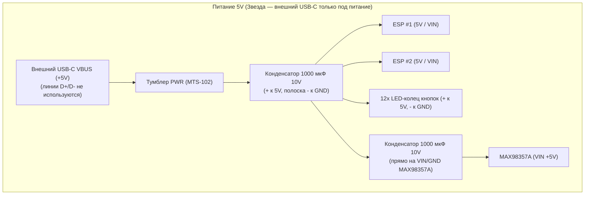
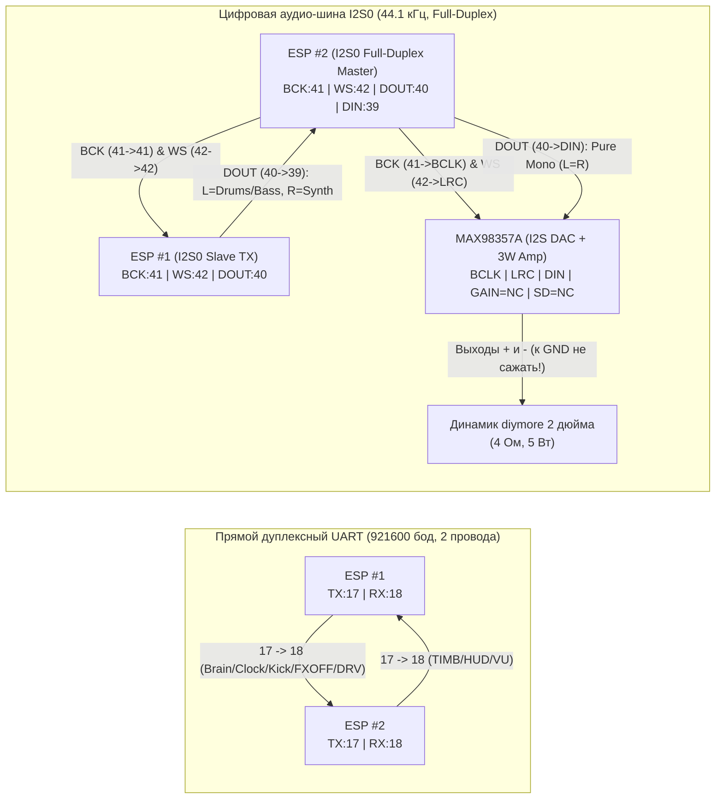

# Безальтернативная карта пинов и Схемы распайки (V5.2 Pure Digital Mono)

Обе голые платы `ESP32-S3 DevKitC-1 N16R8`, расширитель `PCF8575` и модуль `MAX98357A` устанавливаются на внутренний печатный мостик `pcb_bridge` выводами вверх, а портами Type-C в сторону открытого коридора (для прямой прошивки без снятия плат). Внутри корпуса нет ни USB-хаба, ни аналоговых звуковых линий.

> **ЗОЛОТОЕ ПРАВИЛО ПИНОВ `ESP32-S3 N16R8` (Octal PSRAM):**
> * **`GPIO 26-37` — ЗАПРЕЩЕНЫ** (заняты внутри чипа под 8 МБ Octal PSRAM и 16 МБ Flash).
> * **`GPIO 19, 20` — ОСТАВЛЯЕМ СВОБОДНЫМИ** (зарезервированы за встроенным нативным портом `USB` на каждой плате для беспроблемной прошивки и отладки).
> * **`GPIO 0, 45, 46` — НЕ ИСПОЛЬЗУЕМ** (загрузочные strapping-пины; подача HIGH на `GPIO 45` при старте нарушает питание Flash/PSRAM).
> * **`GPIO 43, 44` — СВОБОДНЫЙ РЕЗЕРВ** (`GPIO 43` на `#1` при желании — подсветка TFT-экрана; `GPIO 44` на `#1` — опциональный одиночный клик энкодера `BPM` для сдвига тоники).

---

## 1. Карта пинов обеих плат `ESP32-S3 N16R8` (26 из 26 чистых GPIO на каждой)

| Узел / Функция | `ESP #1`: BRAIN & SOUND ENGINE | `ESP #2`: WARP FX, GHOST & OUTPUT |
| :--- | :--- | :--- |
| **Встроенный USB-C платы** | `GPIO 19/20` (не паять — родной порт `USB`) | `GPIO 19/20` (не паять — родной порт `USB`) |
| **Прямой `UART` (`921600`)** | `GPIO 17` (TX -> `#2` `18`) `GPIO 18` (RX <- `#2` `17`) | `GPIO 17` (TX -> `#1` `18`) `GPIO 18` (RX <- `#1` `17`) |
| **Аудио-шина `I2S0`** *(Full-Duplex)* | `GPIO 41` (BCK In <- `#2` `41`) `GPIO 42` (WS In <- `#2` `42`) `GPIO 40` (DOUT -> `#2` `39`) | `GPIO 41` (**BCK Master** -> `#1` `41` + `MAX98357A BCLK`) `GPIO 42` (**WS Master** -> `#1` `42` + `MAX98357A LRC`) `GPIO 40` (**DOUT** -> `MAX98357A DIN`) `GPIO 39` (**DIN** <- `#1` `40`) |
| **Экран `~2.9"` (SPI)** *(или I2C)* | `GPIO 1` (SCK), `GPIO 2` (MOSI) `GPIO 3` (CS), `GPIO 8` (DC) `GPIO 9` (RES) *(Если I2C: `SDA=47`, `SCL=48` на общую шину с `PCF8575`)* | *Не используется* |
| **I2C Экспандер `PCF8575`** | `GPIO 47` (SDA), `GPIO 48` (SCL) *(Питание строго от `3.3V` + `GND`)* | *Не используется* |
| **4x Потенциометра (`ADC1`)** | *Не используются* | `GPIO 1` (`HIGH`, `ADC1_CH0`) `GPIO 2` (`MID`, `ADC1_CH1`) `GPIO 3` (`LOW`, `ADC1_CH2`) `GPIO 4` (**`VOLUME`**, `ADC1_CH3`) |
| **Энкодеры `EC11` (Фазы `A / B`)** | **1. `BPM`:** `GPIO 4 / 5` **2. `TENS`:** `GPIO 6 / 7` **3. `DEJA`:** `GPIO 15 / 16` **4. `DENS`:** `GPIO 10 / 11` **5. `BEAT`:** `GPIO 12 / 13` **6. `CUT`:** `GPIO 14 / 21` **7. `GROWL`:** `GPIO 38 / 39` | **8. `SHIM`:** `GPIO 5 / 6` **9. `ECHO`:** `GPIO 7 / 8` **10. `PUMP`:** `GPIO 9 / 10` **11. `GHOST`:** `GPIO 11 / 14` **12. `TIMB`:** `GPIO 15 / 16` *(уходит в `#1` по UART)* |
| **Тумблеры прямые** *(на `GND`)* | *Все 6 тумблеров вынесены на `PCF8575`* | **`SPACE` (`MTS-103`):** `GPIO 12` (Up), `GPIO 13` (Down) |
| **Кнопки прямые** *(на `GND`)* | *Все 8 кнопок вынесены на `PCF8575`* | **`STUT`:** `GPIO 21` **`STOP`:** `GPIO 38` **`RISE`:** `GPIO 47` **`VOX`:** `GPIO 48` |
| **Итого занято GPIO** | **26 из 26 чистых** *(+ резерв `43, 44`)* | **26 из 26 чистых** *(+ резерв `43, 44`)* |

---

## 2. Карта входов на расширителе `PCF8575` (16 из 16, I2C `ESP #1` `47/48`)

Все кнопки и тумблеры на `PCF8575` замыкают свой вход на **`GND`** (в коде на все 16 бит пишется `0xFFFF` для активации встроенных подтяжек). Адресные перемычки `A0/A1/A2` — заводские (автосканирование `0x20-0x27` при старте).

| Пин `PCF8575` | Бит | Орган управления | Группа / Куда идет логика |
| :--- | :---: | :--- | :--- |
| **`P00`** | 0 | Кнопка **`SEED`** | 01 BRAIN (Зеленые -> `ESP #1`) |
| **`P01`** | 1 | Кнопка **`MUT`** | 01 BRAIN (Зеленые -> `ESP #1`) |
| **`P02`** | 2 | Кнопка **`ARP`** | 01 BRAIN (Зеленые -> `ESP #1`) |
| **`P03`** | 3 | Кнопка **`TAP`** | 01 BRAIN (Зеленые -> `ESP #1`) |
| **`P04`** | 4 | Кнопка **`SOLO`** | 02 SOUND (Синие -> `ESP #1`) |
| **`P05`** | 5 | Кнопка **`FILL`** | 02 SOUND (Синие -> `ESP #1`) |
| **`P06`** | 6 | Кнопка **`OCT-`** | 02 SOUND (Синие -> `ESP #1`) |
| **`P07`** | 7 | Кнопка **`OCT+`** | 02 SOUND (Синие -> `ESP #1`) |
| **`P10`** | 8 | Тумблер **`GENRE`** — Up (`MTS-103`) | 01 BRAIN (`ESP #1`) |
| **`P11`** | 9 | Тумблер **`GENRE`** — Down (`MTS-103`) | 01 BRAIN (`ESP #1`) |
| **`P12`** | 10 | Тумблер **`MOOD`** (`MTS-102`) | 01 BRAIN (`ESP #1`) |
| **`P13`** | 11 | Тумблер **`ENG`** — Up (`MTS-103`) | 02 SOUND (`ESP #1`) |
| **`P14`** | 12 | Тумблер **`ENG`** — Down (`MTS-103`) | 02 SOUND (`ESP #1`) |
| **`P15`** | 13 | Тумблер **`DKILL`** (`MTS-102`) | 02 SOUND (`ESP #1`) |
| **`P16`** | 14 | Тумблер **`FXOFF`** (`MTS-102`) | 03 WARP FX (`ESP #1` -> UART -> `ESP #2`) |
| **`P17`** | 15 | Тумблер **`DRV`** (`MTS-102`) | Master Digital Drive (`ESP #1` -> UART -> `ESP #2`) |

### Правила распайки органов управления и подсветки
* **Подсветка всех 12 кнопок (`12mm LED 3-6V`):** Все контакты `+` светодиодов объединяются и подключаются **напрямую к шине `+5V`** (после тумблера `PWR`); все контакты `-` — на общий **`GND`**. *(Если в темноте покажется слишком ярко — добавь один общий резистор `15-33 Ом` в провод `+5V` этой гирлянды).*
* **Энкодеры `EC11`:** Средняя ножка (из тройки) -> `GND`; крайние -> пины `A` и `B` (`INPUT_PULLUP`). Задние 2 ножки кнопки не паяются.
* **Тумблеры `MTS-103` / `MTS-102`:** Центральный контакт -> `GND`, крайние -> пины `PCF8575` или `ESP #2` (`INPUT_PULLUP`).
* **Потенциометры `10 кОм` (`HIGH/MID/LOW/VOLUME` на `ESP #2`):** Левый вывод -> `GND`, правый -> `3.3V` (с `ESP #2`), средний ползунок -> `GPIO 1 / 2 / 3 / 4`.

---

## 3. Питание, Прямой UART и Цифровая шина `I2S0` + `MAX98357A`

---

## 4. Критические правила: `MAX98357A` и Прошивка без USB-хаба

### Подключение `MAX98357A`
| Пин на `MAX98357A` | Куда подключать | Примечание |
| :--- | :--- | :--- |
| **`VIN`** | Шина **`+5V`** (после тумблера `PWR`) | Прямо на пинах `VIN` и `GND` платы впаять конденсатор **`1000 мкФ 10 В`** (полоска `-` к `GND`) — гасит просадки на ударах бочки. |
| **`GND`** | Общая земля **`GND`** | Короткий толстый провод к общей точке звезды. |
| **`BCLK`** | `ESP #2` **`GPIO 41`** | Общий такт `BCK` с `ESP #1`. |
| **`LRC`** | `ESP #2` **`GPIO 42`** | Общий такт `WS` с `ESP #1`. |
| **`DIN`** | `ESP #2` **`GPIO 40`** | Цифровой выход обработанного моно-звука. |
| **`GAIN`** | **Не подключать (оставить свободным)** | По умолчанию дает чистые **`9 дБ`** усиления без хрипа. *(Громче: `GND` = `12 дБ`; тише: `VIN` = `6 дБ`).* |
| **`SD`** | **Не подключать (оставить свободным)** | Встроенная подтяжка на плате включает режим суммирования `$(L + R)/2$` — так как `ESP #2` шлет в оба слота одинаковый моно-сигнал, уровень ровно `0 дБ`. |
| **`+` / `-` (Выход)** | **Строго на динамик `diymore 2"`** | **НИКОГДА не замыкай `-` на `GND` и не подключай сюда наушники/AUX** — это мостовой усилитель класса D, чип сгорит. |

### Правила безопасности при прямой прошивке (без хаба)
1. **Тумблер `PWR` в положение `OFF`** (и отключить внешний Powerbank/БП от заднего разъема `USB-C`) перед подключением кабеля от ПК к любой из двух плат — чтобы не соединить два разных источника `5 В`.
2. **Ручку `VOLUME` выкрутить в ноль** на время прошивки, чтобы усилитель не дергал пиковый ток от USB-порта ноутбука (на `ESP32-S3 DevKitC-1` шина `5V` общая: подключенная к ПК плата запитает и вторую плату + LED кнопок, суммарно `~340 мА`).
3. **Задний разъем `USB-C` для Powerbank:** Если питаешь прибор кабелем `USB-C <-> USB-C` от современного PD-повербанка, убедись, что на твоей плате врезного `USB-C` стоят резисторы `5.1 кОм` на линиях `CC1/CC2` (у большинства 6-пиновых модулей их нет, поэтому кабель `USB-A -> USB-C` работает всегда гарантированно).
