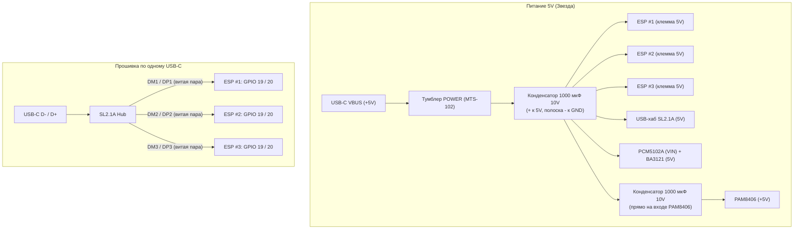
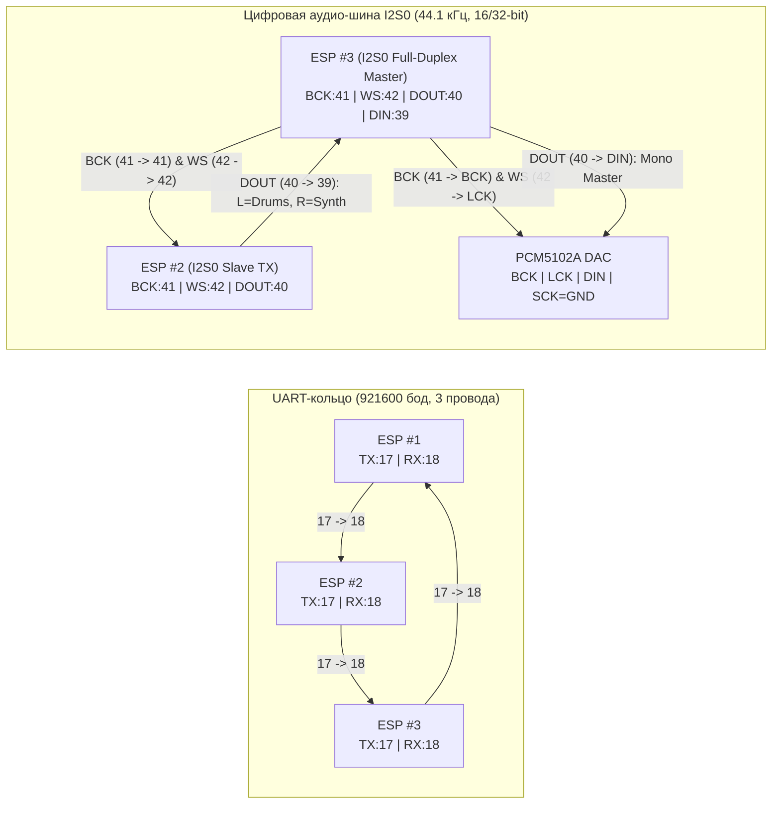
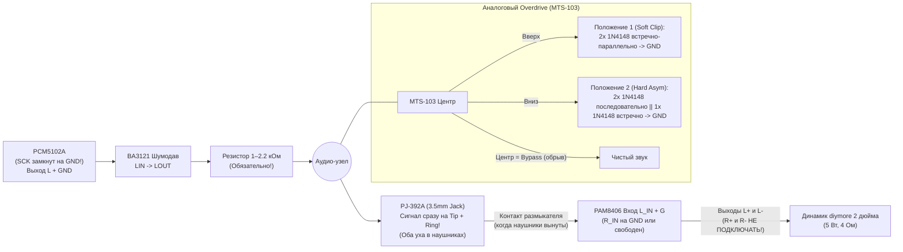

# Карта пинов и Схемы распайки (V4.0)

Все 3 платы `ESP32-S3 N16R8` устанавливаются в винтовые клеммные базы `S3 Expansion Board A`.

> **ЗОЛОТОЕ ПРАВИЛО ПИНОВ `ESP32-S3 N16R8` (Octal PSRAM):**
> * **`GPIO 26–37` — ЗАПРЕЩЕНЫ** (заняты внутри чипа под Octal PSRAM 8 МБ и Flash 16 МБ).
> * **`GPIO 19, 20` — ТОЛЬКО USB** (подключены к внутреннему хабу `SL2.1A`).
> * **`GPIO 0, 45, 46` — НЕ ИСПОЛЬЗУЕМ** (загрузочные strapping-пины; подача HIGH на `GPIO 45` при старте ломает питание Flash/PSRAM).

## 1. Сводная таблица пинов всех 3 плат (Унифицированная раскладка)

Обрати внимание: пины USB (`19/20`), UART-кольца (`17/18`), всех 4 энкодеров (`4–7`, `15–16`, `10–11`), обоих тумблеров (`12–14`) и первых двух кнопок с их светодиодами (`21/38`, `47/48`) **абсолютно одинаковые на всех трех платах**. Это делает код и монтаж максимально прозрачными.

| Узел / Функция | `ESP #1`: BRAIN & UI *(Линия 1 + Верх)* | `ESP #2`: SOUND ENGINE *(Линия 2)* | `ESP #3`: WARP FX & GHOST *(Линия 3)* |
| :--- | :--- | :--- | :--- |
| **USB Прошивка (`SL2.1A`)** | `GPIO 19` (D-), `GPIO 20` (D+) | `GPIO 19` (D-), `GPIO 20` (D+) | `GPIO 19` (D-), `GPIO 20` (D+) |
| **UART-кольцо (921600)** | `GPIO 17` (TX → #2 RX) `GPIO 18` (RX ← #3 TX) | `GPIO 17` (TX → #3 RX) `GPIO 18` (RX ← #1 TX) | `GPIO 17` (TX → #1 RX) `GPIO 18` (RX ← #2 TX) |
| **Аудио-шина I2S** *(Full-Duplex Dual-Mono)* | *Не используется* | `GPIO 41` (BCK In ← #3) `GPIO 42` (WS In ← #3) `GPIO 40` (DOUT → #3 `39`) | `GPIO 41` (**BCK Master Out** → #2 + DAC) `GPIO 42` (**WS Master Out** → #2 + DAC) `GPIO 40` (**DOUT** → `PCM5102A DIN`) `GPIO 39` (**DIN** ← #2 `40`) |
| **OLED 128×64 (I2C)** | `GPIO 8` (SDA), `GPIO 9` (SCL) | *Свободно (резерв)* | *Занято кнопками 3–4* |
| **Потенциометры EQ (ADC1)** | `GPIO 1` (`LOW`) `GPIO 2` (`MID`) `GPIO 3` (`HIGH`) | *Свободно (резерв)* | *`1, 2` заняты LED 3–4; `3` свободен* |
| **Энкодер 1 (`A / B`)** | `GPIO 4 / 5` (`BPM`) | `GPIO 4 / 5` (`Grids Map`) | `GPIO 4 / 5` (`Shimmer`) |
| **Энкодер 2 (`A / B`)** | `GPIO 6 / 7` (`Tension & Res`) | `GPIO 6 / 7` (`Bass Cutoff`) | `GPIO 6 / 7` (`Echo FB`) |
| **Энкодер 3 (`A / B`)** | `GPIO 15 / 16` (`Déjà Vu`) | `GPIO 15 / 16` (`Bass Growl`) | `GPIO 15 / 16` (`Sidechain Pump`) |
| **Энкодер 4 (`A / B`)** | `GPIO 10 / 11` (`Melody Density`) | `GPIO 10 / 11` (`Synth Timbre`) | `GPIO 10 / 11` (`Ghost Ether`) |
| **Тумблер 1 (`MTS-103`, 3 поз.)** | `GPIO 12` (Up), `GPIO 13` (Down) *(`Genre DNA`)* | `GPIO 12` (Up), `GPIO 13` (Down) *(`Synth Engine`)* | `GPIO 12` (Up), `GPIO 13` (Down) *(`Space Mode`)* |
| **Тумблер 2 (`MTS-102`, 2 поз.)** | `GPIO 14` *(`Mood`)* | `GPIO 14` *(`Drums Kill`)* | `GPIO 14` *(`FX Kill`)* |
| **Кнопка 1** *(вход на GND)* | `GPIO 21` (`NEW SEED`) | `GPIO 21` (`BEAT SOLO`) | `GPIO 21` (`STUTTER`) |
| **Кнопка 2** *(вход на GND)* | `GPIO 38` (`MUTATE`) | `GPIO 38` (`OCTAVE +1`) | `GPIO 38` (`TAPE STOP`) |
| **Кнопка 3** *(вход на GND)* | `GPIO 39` (`HOLD ARP`) | *Заглушка (резерв: `8`)* | `GPIO 8` (`AUTO-RISER`) |
| **Кнопка 4** *(вход на GND)* | `GPIO 40` (`TAP TEMPO`) | *Заглушка (резерв: `9`)* | `GPIO 9` (`RADIO VOICE`) |
| **LED Кнопки 1** *(ШИМ 3.3 В)* | `GPIO 47` | `GPIO 47` | `GPIO 47` |
| **LED Кнопки 2** *(ШИМ 3.3 В)* | `GPIO 48` | `GPIO 48` | `GPIO 48` |
| **LED Кнопки 3** *(ШИМ 3.3 В)* | `GPIO 41` | *Заглушка (резерв: `1`)* | `GPIO 1` |
| **LED Кнопки 4** *(ШИМ 3.3 В)* | `GPIO 42` | *Заглушка (резерв: `2`)* | `GPIO 2` |
| **Итого занято GPIO** | **26 из 28** *(резерв: `43, 44`)* | **20 из 28** *(резерв: `1,2,3,8,9,39,43,44`)* | **25 из 28** *(резерв: `3, 43, 44`)* |

### Правила подключения органов управления
* **Энкодеры `EC11`:** Средний контакт группы из 3 ножек → `GND`. Крайние контакты → пины `A` и `B` в таблице (в коде `INPUT_PULLUP`). Два контакта кнопки с обратной стороны энкодера остаются неподключенными.
* **Тумблеры `MTS-103` / `MTS-102`:** Центральный контакт → `GND`, крайние → соответствующие GPIO (`INPUT_PULLUP`).
* **Кнопки 12mm LED (4 контакта на каждой):** Два контакта самой кнопки → `GPIO` (`INPUT_PULLUP`) и `GND`. Светодиод: `+` → `GPIO LED` (ШИМ 3.3 В), `-` → `GND`. *(Перед массовой пайкой проверь мультиметром ток одного светодиода кнопки от 3.3 В: при токе до 15 мА подключается напрямую; если вдруг окажется выше 20 мА — добавь последовательный резистор `100–220 Ом`).*
* **Потенциометры `10 кОм` (EQ):** Левый вывод → `GND`, правый → `3.3V` (с `ESP #1`), средний (ползунок) → `GPIO 1 / 2 / 3`.

## 2. Схема цифровых шин: Питание, USB-хаб, UART-кольцо и I2S

## 3. Схема аналогового Моно-тракта и Диодного Овердрайва

### Критические правила пайки аналога (проверить дважды!)
1. **Пин `SCK` на плате `PCM5102A`:** Обязательно замкни его на `GND` (либо запаяй перемычку `H1L/SCK` на плате ЦАП), иначе `PCM5102A` не запустит внутренний PLL и звука не будет.
2. **Токоограничивающий резистор `1–2.2 кОм` после `BA3121`:** Ставится строго **ДО** точки подключения тумблера с диодами `1N4148`. Без него диоды при клиппинге замкнут выход операционника `BA3121` напрямую на $0.6\ \text{В}$, что вызовет искажение питания и перегрузку чипа.
3. **Сборка диодного клиппинга на `MTS-103`:**
   * Центральный вывод `MTS-103` — к сигнальной точке после резистора `1–2.2 кОм`.
   * *Положение 1 (Soft Clip):* Два диода `1N4148` параллельно друг другу в **противоположных направлениях** (`A→K` и `K→A`) от верхнего вывода тумблера на `GND`.
   * *Положение 2 (Hard Asym):* В одном направлении — **один** диод `1N4148`, в противоположном — **два** диода `1N4148` последовательно (от нижнего вывода тумблера на `GND`). Несимметричное ограничение рождает теплые четные гармоники.
4. **Гнездо наушников `PJ-392A` (5 контактов):** Чтобы в стерео-наушниках играли оба уха, спаяй перемычкой выводы `Tip` (левый канал) и `Ring` (правый канал) и подай на них наш моно-сигнал. Один из размыкающих контактов (который замкнут с `Tip`, когда штекер вынут) уводи на вход `L_IN` усилителя `PAM8406`.
5. **Усилитель `PAM8406` в моно-режиме:**
   * Это мостовой усилитель класса D — вывод **`L-` НЕЛЬЗЯ соединять с общей землей `GND`**, оба провода (`L+` и `L-`) идут напрямую к клеммам динамика.
   * Неиспользуемые выходы **`R+` и `R-` оставить в воздухе** (никогда не соединять с `L+/L-` и не коротить на землю).
   * Второй электролитический конденсатор `1000 мкФ 10В` припаять максимально близко к контактам питания `+5V` и `GND` платы `PAM8406`.
